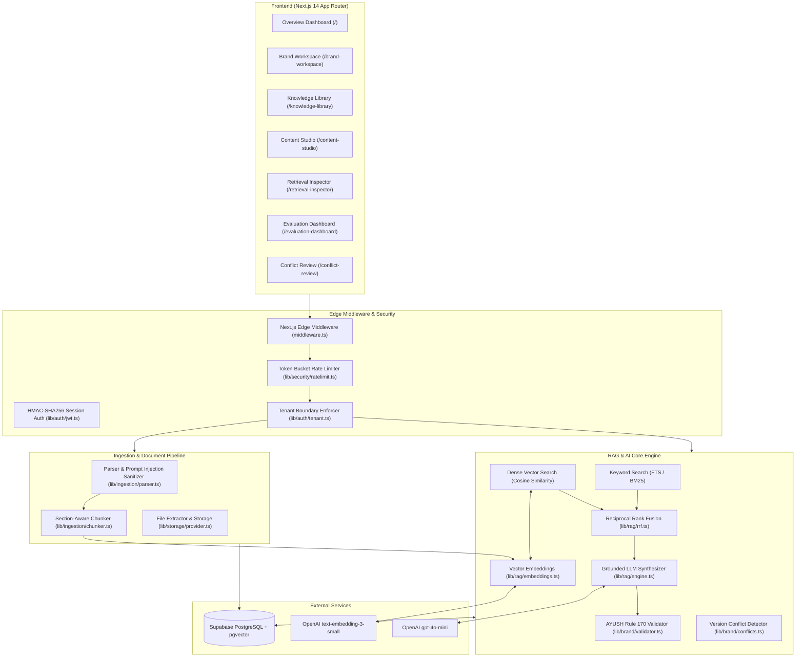

# BrandMemory — Complete System Architecture & Operational Guide

---

## 1. Executive Summary & Problem Solved

**BrandMemory** is an enterprise-grade **Editorial Provenance & Retrieval-Augmented Generation (RAG) SaaS platform**. 

### The Problem It Solves
When health, wellness, and clinical brands generate marketing content using standard generative AI models (like ChatGPT), they face three major existential risks:
1. **Hallucination & Fake Claims:** AI models invent statistics, trial metrics, or efficacy percentages that have no factual basis in certified lab studies.
2. **Regulatory Penalties (AYUSH Rule 170 & FTC):** Botanical and health formulations are strictly regulated by laws prohibiting curative claims (e.g., claiming to "cure eczema" or "treat acute psoriasis"). Marketing copy must remain within supportive wellness boundaries substantiated by clinical trials.
3. **Document Version Contradictions:** Companies frequently update trial monographs and product dosing. If an AI references an obsolete version, contradictory or dangerous guidance reaches public marketing channels.

### The BrandMemory Solution
BrandMemory enforces **Editorial Provenance**: Every generated marketing sentence is mathematically grounded in verified brand research documents, clinical trial PDFs, and regulatory monographs. It provides:
- **Clickable inline citations** (`[KB-REF-01]`, `[KB-REF-02]`) linked to verified passage excerpts.
- **Evidence Inspector side-drawer** showing underlying evidence text, source page numbers, and confidence ratings.
- **Automated Brand Governance Engine** that scans content against AYUSH Rule 170 regulations and flags unauthorized claims.
- **Hybrid Retrieval (RRF)** combining PostgreSQL Full-Text Search with 1536-dimensional dense vector embeddings.
- **Multi-Tenant Isolation** ensuring competitors' trade secrets and formulations never leak across workspaces.

---

## 2. High-Level System Architecture

The following diagram illustrates how all components connect—from document upload down to the database and OpenAI:



---

## 3. How a Request Works (Step-by-Step Data Flow)

### Flow A: Ingesting a Brand Document
```
[User uploads PDF/DOCX/MD] 
       ↓ 
[POST /api/documents] 
       ↓ 
[parseDocumentContent()]
  • Sanitizes text & strips prompt injection payloads (e.g., "ignore previous instructions")
  • Identifies headers, trial metadata, and sections
       ↓ 
[chunkParsedDocument()]
  • Chunks document while preserving Section Title, Page Number, and Approval Tier
  • Assigns unique citation reference tags (e.g., KB-REF-01)
       ↓ 
[generateEmbedding()]
  • Sends text to OpenAI `text-embedding-3-small` (1536-dimensional float vector)
  • Normalizes vector using L2 norm
       ↓ 
[PostgreSQL Database / Supabase]
  • Saves document metadata into `documents` table
  • Saves chunk and 1536-dim vector into `document_chunks` table with `pgvector`
```

---

### Flow B: Grounded Marketing Content Generation
```
[User submits prompt: "Write product copy for Bakuchiol Night Serum"]
       ↓
[POST /api/generate]
       ↓
[checkRateLimit()] — Protects against DDoS and API credit depletion
       ↓
[searchHybrid(prompt, workspaceId, k=4)]
  1. Dense Search: Generates query vector via OpenAI and computes cosine similarity.
  2. Keyword Search: Tokenizes prompt and scores exact and partial keyword hits.
  3. Reciprocal Rank Fusion (RRF): Combines ranks with smoothing parameter k=60:
         RRF_Score = 1/(60 + Rank_Keyword) + 1/(60 + Rank_Dense)
       ↓
[Evidence Quality Check]
  • If RRF score < 0.015: Returns "Insufficient Evidence Notice"
  • If evidence found: Formats top passages into structured context
       ↓
[OpenAI gpt-4o-mini Call]
  • Sends System Prompt with strict Groundedness and AYUSH Rule 170 rules
  • Requests strict JSON response containing `generatedText` and `citations` array
       ↓
[validateContentAgainstBrandRules()]
  • Scans generated copy for prohibited hype words ("miracle", "100% cure", "instant fix")
  • Confirms claims match the approved clinical trial registry
       ↓
[Response Returned to UI]
  • Renders copy with clickable citation buttons
  • Opens evidence inspector side-drawer displaying source documents and pages
```

---

## 4. Deep Dive: The 7 Core Application Screens

| Screen Route | View Title | What It Does & Key Features |
|---|---|---|
| [`/`](file:///c:/Users/Khushi/Downloads/BrandMemory/app/page.tsx) | **Overview Dashboard** | Health telemetry, total active documents, chunk indexing velocity, recent campaign drafts, retrieval accuracy metrics, and top-level workspace switcher. |
| [`/brand-workspace`](file:///c:/Users/Khushi/Downloads/BrandMemory/app/brand-workspace/page.tsx) | **Brand Workspace** | Brand identity configuration: Brand voice pillars, target audience personas, approved clinical claims registry with statutory backing, and prohibited phrase dictionary. |
| [`/knowledge-library`](file:///c:/Users/Khushi/Downloads/BrandMemory/app/knowledge-library/page.tsx) | **Knowledge Library** | Document ingestion repository supporting PDF, DOCX, TXT, and Markdown files. Features a live document chunk inspector, approval status badges, and AYUSH metadata tags. |
| [`/content-studio`](file:///c:/Users/Khushi/Downloads/BrandMemory/app/content-studio/page.tsx) | **Content Studio** | AI copywriting workspace with channel selectors (E-Commerce PDP, Instagram Ad, Email Campaign, Print Editorial). Features inline citation tags `[KB-REF-01]` and an interactive **Evidence Inspector Drawer**. |
| [`/retrieval-inspector`](file:///c:/Users/Khushi/Downloads/BrandMemory/app/retrieval-inspector/page.tsx) | **Retrieval Inspector** | 3-column diagnostic matrix comparing **Keyword Search (BM25)**, **Dense Vector (Cosine Similarity)**, and **Hybrid RRF** side-by-side with execution latencies. |
| [`/evaluation-dashboard`](file:///c:/Users/Khushi/Downloads/BrandMemory/app/evaluation-dashboard/page.tsx) | **Evaluation Dashboard** | Empirical RAG benchmark tracking Recall@1, Recall@3, Recall@5, MRR (Mean Reciprocal Rank), Citation Accuracy, and Live Golden Dataset sweeps. |
| [`/conflict-review`](file:///c:/Users/Khushi/Downloads/BrandMemory/app/conflict-review/page.tsx) | **Conflict Review** | Automated document version conflict reconciliation. Compares contradictory guidelines (e.g. conflicting Bakuchiol sun safety recommendations) with human-in-the-loop sign-off actions. |

---

## 5. Algorithmic Engines & Core Logic

### 1. Vector Embeddings (`lib/rag/embeddings.ts`)
- **Model:** OpenAI `text-embedding-3-small`.
- **Dimensions:** 1536 floating-point values.
- **Normalization:** Vectors undergo L2 normalization (Euclidean norm = 1.0), meaning dot products directly equal cosine similarity.
- **Deterministic Fallback:** If offline or in demo mode, an n-gram vocabulary hashing algorithm creates mathematically stable 1536-dim vectors with zero API dependency.

### 2. Reciprocal Rank Fusion (`lib/rag/rrf.ts`)
Instead of naively adding vector scores (0.0 to 1.0) to keyword BM25 scores (arbitrary scale), BrandMemory uses **Reciprocal Rank Fusion**:
$$\text{RRF Score}(d) = \sum_{m \in M} \frac{1}{k + r_m(d)}$$
Where:
- $M$ is the set of retrieval systems (Keyword + Vector)
- $r_m(d)$ is the rank of document $d$ in system $m$ (1-indexed)
- $k = 60$ is the standard smoothing constant

Candidates appearing high in both retrieval lists receive exponential boosts, avoiding calibration mismatches between sparse and dense scores.

### 3. Statutory Compliance Engine (`lib/brand/validator.ts`)
Under Indian **AYUSH Rule 170** and international health advertising laws, cosmetic and wellness brands are barred from claiming to treat, diagnose, or cure illnesses.
The validator continuously scans text for prohibited patterns:
- **Disallowed:** "cures eczema", "permanent psoriasis eradication", "100% miracle remedy".
- **Allowed:** "supports barrier resilience", "clinically measured fine line reduction", "supports skin radiance".
If violations occur, the UI displays warning alerts and downgrades the Groundedness Score.

### 4. Version Conflict Detector (`lib/brand/conflicts.ts`)
When new product documentation is uploaded, the conflict engine compares existing knowledge chunks against the new version for:
- Dosage inconsistencies (e.g., 2 drops vs 10 drops).
- Contradictory contraindications (e.g., "safe for UV-A exposure" vs "strictly nighttime only").
Discrepancies are routed to `/conflict-review` for human approval:
- **Affirm Document A**
- **Condition Usage**
- **Supersede Older Version**

---

## 6. Multi-Tenancy, Security & Database

### Multi-Tenant Isolation
BrandMemory enforces strict tenant isolation across all layers:
- Every query mandates `workspace_id = $1`.
- Built-in demo tenants include:
  - `ws-kalyani-botanicals`: Ayurvedic Clinical Formulations & Skin Science
  - `ws-vedic-wellness`: Nutraceuticals & Dietary Adaptogens
  - `ws-aurora-derma`: Biotech Dermaceuticals
- Chunks and documents from one workspace are mathematically excluded from search spaces of other tenants.

### Edge Middleware & JWT Session Auth
- [`middleware.ts`](file:///c:/Users/Khushi/Downloads/BrandMemory/middleware.ts): Intercepts requests, inspects `brandmemory_workspace` cookies or `x-workspace-id` headers, and passes validated headers downstream.
- [`lib/auth/jwt.ts`](file:///c:/Users/Khushi/Downloads/BrandMemory/lib/auth/jwt.ts): Generates and verifies HMAC-SHA256 session tokens with expiration and workspace role validation.

### Rate Limiting Protection
- [`lib/security/ratelimit.ts`](file:///c:/Users/Khushi/Downloads/BrandMemory/lib/security/ratelimit.ts): In-memory sliding-token bucket limiting `/api/generate` to 15 requests per minute per workspace to protect against API credit exhaustion.

### Database Persistence & Schema
The database connects to **Supabase PostgreSQL** via the Connection Pooler and utilizes:
- `CREATE EXTENSION IF NOT EXISTS "vector";`
- `CREATE EXTENSION IF NOT EXISTS "pg_trgm";`
- 10 Relational Tables:
  1. `workspaces`
  2. `users` & `workspace_members`
  3. `brand_rules`
  4. `documents` & `document_versions`
  5. `document_chunks` (with `tsv` TSVECTOR and `embedding` VECTOR(1536))
  6. `document_conflicts`
  7. `campaigns`
  8. `generated_contents`
  9. `evaluation_queries` & `evaluation_runs`

---

## 7. Directory Structure Reference

```
BrandMemory/
├── app/                             # Next.js 14 App Router
│   ├── page.tsx                     # 1. Overview Dashboard
│   ├── brand-workspace/page.tsx     # 2. Brand Voice & Claims Library
│   ├── knowledge-library/page.tsx   # 3. Document Ingestion & Chunk Inspector
│   ├── content-studio/page.tsx      # 4. Grounded AI Content Studio
│   ├── retrieval-inspector/page.tsx # 5. 3-Way Search Diagnostic Matrix
│   ├── evaluation-dashboard/page.tsx# 6. Quantitative RAG Evaluation (Recall/MRR)
│   ├── conflict-review/page.tsx     # 7. Document Version Conflict Review
│   ├── globals.css                  # Editorial Provenance Design System Tokens
│   ├── layout.tsx                   # TopNavBar and SideNavBar Shell
│   └── api/                         # Backend REST API Endpoints
│       ├── brand-rules/route.ts     # Brand Voice & AYUSH Rules
│       ├── conflicts/route.ts       # Version Conflict Resolution
│       ├── documents/route.ts       # Document Ingestion & Chunking
│       ├── evaluation/route.ts      # Empirical Golden Dataset Sweeps
│       ├── generate/route.ts        # Grounded Copy Generator (OpenAI gpt-4o-mini)
│       ├── retrieval/route.ts       # Search Diagnostic Engine
│       └── workspaces/route.ts      # Multi-Tenant Workspace Switcher
│
├── components/                      # UI Component Library
│   ├── navigation/                  # SideNavBar & TopNavBar
│   └── ui/                          # Button, Modal, Card, Input primitives
│
├── lib/                             # Core Business & Algorithmic Logic
│   ├── auth/                        # Multi-Tenant Isolation & JWT Auth
│   │   ├── jwt.ts                   # HMAC-SHA256 Token Signing & Verification
│   │   └── tenant.ts                # Workspace Access Resolver
│   ├── brand/                       # Brand Governance
│   │   ├── validator.ts             # AYUSH Rule 170 & Claim Verification
│   │   └── conflicts.ts             # Version Contradiction Detector
│   ├── db/                          # Database Connection & Migrations
│   │   ├── client.ts                # PostgreSQL Client with pgvector & In-Memory Fallback
│   │   └── schema.sql               # Full PostgreSQL Schema with 10 tables
│   ├── ingestion/                   # Document Parsing
│   │   ├── chunker.ts               # Section-Aware Document Chunker
│   │   ├── extractors.ts            # Text Cleaning & File Extractor
│   │   └── parser.ts                # Text Parser with Prompt Injection Defense
│   ├── rag/                         # Retrieval-Augmented Generation Engine
│   │   ├── embeddings.ts            # OpenAI text-embedding-3-small (1536-dim)
│   │   ├── engine.ts                # Hybrid Search, Seed Knowledge & Synthesizer
│   │   └── rrf.ts                   # Reciprocal Rank Fusion Algorithm (k=60)
│   ├── security/                    # API Defense
│   │   └── ratelimit.ts             # Sliding Token Bucket Rate Limiter
│   └── storage/                     # Document Object Storage
│       └── provider.ts              # LocalStorage & S3/Cloudflare R2 Adapter
│
├── scripts/
│   └── init-db.ts                   # Database Migration & Seed CLI (`npm run db:init`)
│
├── tests/                           # Automated Test Suite (100% Pass Rate)
│   ├── brand_integrity.test.ts      # Tests AYUSH compliance & conflict detection
│   └── retrieval.test.ts            # Tests Embeddings, Cosine Sim, RRF, & Multi-Tenancy
│
├── .env.local                       # Local Environment Credentials (DATABASE_URL, OPENAI)
├── .github/workflows/ci.yml         # GitHub Actions CI Workflow (Lint, Test, Build)
├── Dockerfile                       # Multi-stage production container
├── middleware.ts                    # Edge Tenant Header Routing
└── next.config.mjs                  # Production Security Headers (CSP, HSTS)
```

---

## 8. Developer Operations Quick-Reference

### Running Locally
```powershell
# 1. Start the Next.js development server
npm run dev

# 2. Run automated test suite (8 tests)
npm test

# 3. Initialize or reset database schema & seed data
npm run db:init

# 4. Production build check
npm run build
```

---

*Authored for BrandMemory Platform Architecture & Engineering Reference.*
